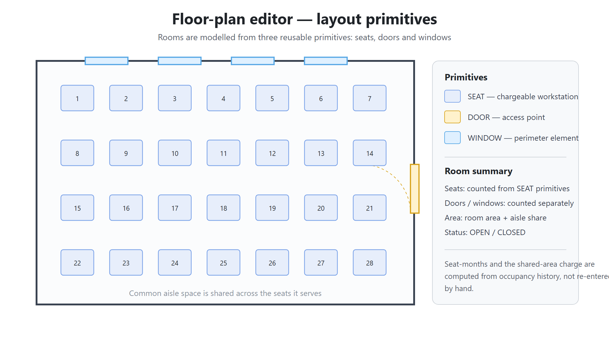
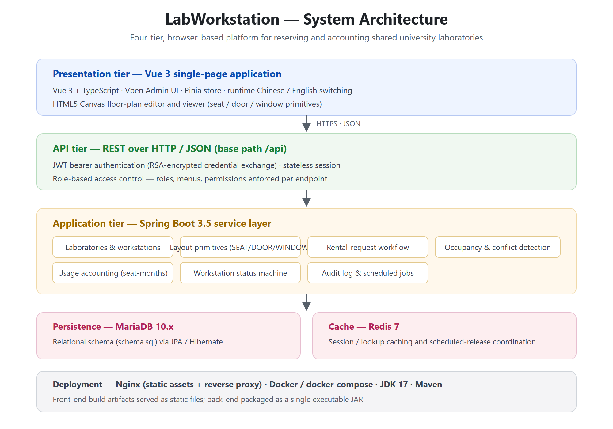
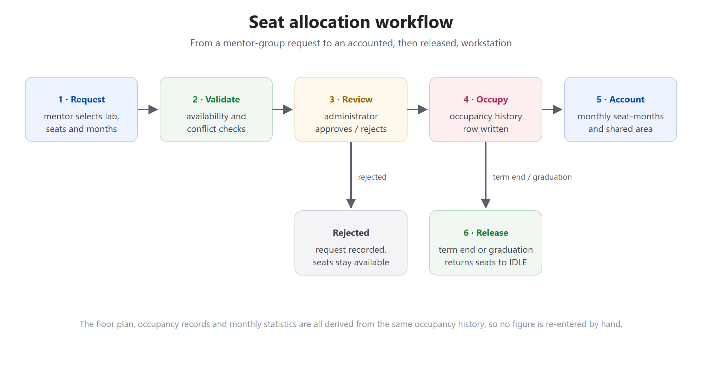
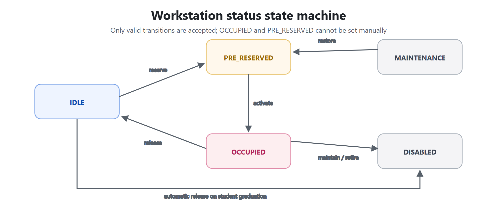

# LabWorkstation

[](LICENSE)
[](https://github.com/tiangao96/Gao1/releases)
[](https://openjdk.org/)
[](https://spring.io/projects/spring-boot)
[](https://vuejs.org/)
[](#citation)

**LabWorkstation** is an open-source, browser-based platform that turns the management of shared
university laboratories into a single accountable workflow. It **visualizes seat allocation on
editable floor plans**, runs a **reviewed reservation workflow**, and **derives monthly
occupancy-based space charges automatically** from the same occupancy records.

> Companion paper: *Visualizing seat allocation and automating space-charge calculations in shared
> university laboratories: The LabWorkstation platform* (submitted to **SoftwareX**).



---

## Why LabWorkstation?

In shared laboratories, workstations are treated as common resources that move between research
groups, go to maintenance, and are charged back by occupied floor area. These events — the group
responsible, the occupancy interval and the floor area — are usually kept in spreadsheets. Entries
change often, the same seat ends up counted twice, and the monthly charge is recomputed by hand
every time.

LabWorkstation keeps one source of truth instead: a **floor plan**, an **occupancy history** and a
**monthly accounting view** are all derived from the same records, so no figure has to be
re-entered.

## Key features

- **Laboratory and workstation modelling** — rooms are composed from three reusable primitives:
  `SEAT`, `DOOR` and `WINDOW`; room area and aisle share are attached to each seat.
- **Visual floor-plan editor and viewer** — an HTML5 Canvas editor for placing and moving seats,
  doors and windows per room.
- **Reviewed reservation workflow** — a mentor group proposes seats and a month range; the
  administrator reviews, approves or rejects the request.
- **Two-stage conflict detection** — availability and overlap are checked before a seat can be held.
- **Workstation status state machine** — `IDLE` → `PRE_RESERVED` → `OCCUPIED`, plus `MAINTENANCE`
  and `DISABLED`; only valid transitions are accepted, and occupied states cannot be set by hand.
- **Monthly usage accounting** — seat-months and shared floor area per mentor group, derived from
  occupancy history rather than manual entry.
- **Role-based access control** — roles, menus and permissions enforced per endpoint.
- **Audit log and scheduled jobs** — operation history plus automatic release of workstations when a
  student cohort graduates.
- **Runtime Chinese / English switching** — one front-end build, switchable at runtime.

## Architecture



| Tier | Technology | Responsibility |
|------|------------|----------------|
| Presentation | Vue 3 + TypeScript, Vben Admin, Pinia, HTML5 Canvas | floor-plan editor/viewer, admin console, mentor and student views |
| API | REST over HTTP/JSON (`/api`), JWT | authentication (RSA-encrypted credential exchange), request validation |
| Application | Spring Boot 3.5 (Java 17) | labs, workstations, reservation workflow, occupancy history, accounting |
| Persistence | MariaDB 10.x, Redis 7 | relational schema via JPA/Hibernate; session/lookup cache |
| Deployment | Nginx, Docker, Maven | static assets + reverse proxy, packaged as a single executable JAR |

## Seat allocation workflow





## Tech stack

- **Backend:** Java 17, Spring Boot 3.5, Spring Security, Spring Data JPA, Maven
- **Frontend:** Vue 3, TypeScript, Vben Admin, Pinia, Vite build output served as static files
- **Data:** MariaDB 10.5+ (MySQL 8 compatible), Redis 7
- **Runtime:** Nginx, Docker / docker-compose, JDK 17

## Repository layout

```
src/                     Backend source (Spring Boot 3.5, Java 17, Maven)
pom.xml mvnw mvnw.cmd    Maven build (wrapper included)
frontend/                Built frontend assets (Vue 3 + Vben Admin), served as static files
sql/                     schema.sql (DDL), data.sql (demo seed), mentor_menu.sql
deploy/                  nginx config, dev/deploy scripts, app.env.example
docs/images/             Diagrams used in this README
Dockerfile docker-compose.yml
LICENSE CITATION.cff .zenodo.json
```

## Getting started

### Prerequisites

- JDK 17, Maven (or the bundled `./mvnw`)
- MariaDB 10.5+ / MySQL 8, Redis 7
- Node.js ≥ 18 (only if you rebuild the front-end)
- Nginx (to serve the static front-end)

### Option A — Docker Compose

```bash
docker compose up --build
```

### Option B — Manual build

```bash
./mvnw -DskipTests package          # produces target/lab-server-0.1.0.jar
```

1. Create the database with `sql/schema.sql`.
2. Load `sql/data.sql` (minimal demo dataset) and `sql/mentor_menu.sql`.
3. Configure the database/Redis connection (see `deploy/app.env.example`), then run:

```bash
java -jar target/lab-server-0.1.0.jar --spring.profiles.active=prod
```

The `frontend/` folder can be served directly by Nginx (see `deploy/lab-reservation.conf`).

### Configuration

Database, Redis and server settings are read from environment variables / the active Spring profile
(`application-dev.yml`, `application-prod.yml`). Copy `deploy/app.env.example` and fill in your own
values; no credentials are committed to this repository.

### Demo data

`sql/data.sql` seeds a **minimal demo** dataset (RBAC roles/menus, one lab, a couple of
workstations, and the demo accounts `admin / admin123` and `user / user123`). It contains **no real
personal data**.

## Data model (high level)

- `Lab` — a room, with area, status and a layout of primitives.
- `Workstation` — a chargeable seat (`SEAT`), or a `DOOR` / `WINDOW` primitive, positioned on the
  floor plan.
- `WorkstationRentalRequest` / `...Item` — a mentor group's request and the seats it asks for.
- `WorkstationOccupancyHistory` — the occupancy intervals used by both the floor plan and the
  monthly accounting.
- `CoreUser`, `CoreMentorGroup`, `CoreRole`, `CoreMenu`, `CorePermission` — RBAC and group
  ownership.

## Validation and limitations

The platform has been deployed and validated in a single faculty, with typical allocation scenarios
exercised end-to-end (request → review → occupancy → accounting → release). Known limitations
include single-faculty validation so far, and behaviour at larger, multi-faculty scale (including
concurrent editing of the same floor plan) is not yet characterized.

## Citation

If you use LabWorkstation in academic work, please cite it. Machine-readable metadata is provided in
[`CITATION.cff`](CITATION.cff); a DOI will be minted via Zenodo on the first archived release.

```bibtex
@software{labworkstation,
  title        = {LabWorkstation: Visualizing seat allocation and automating space-charge
                  calculations in shared university laboratories},
  author       = {Gao, Tian and Ye, AiPeng and Huang, GuiJian and Gao, ZhiJian and Ou, Yang Yang},
  year         = {2026},
  version      = {1.0.0},
  license      = {MIT},
  url          = {https://github.com/tiangao96/Gao1}
}
```

## License

Released under the [MIT License](LICENSE).

## Acknowledgements

This work was supported by the Research Fund for Laboratory and Equipment Management of Shenzhen
University (Grant No. 309-000002031251).

---

> The figures above are **schematic architecture and workflow diagrams**, not screenshots of live
> data. The repository ships only synthetic demo data.
